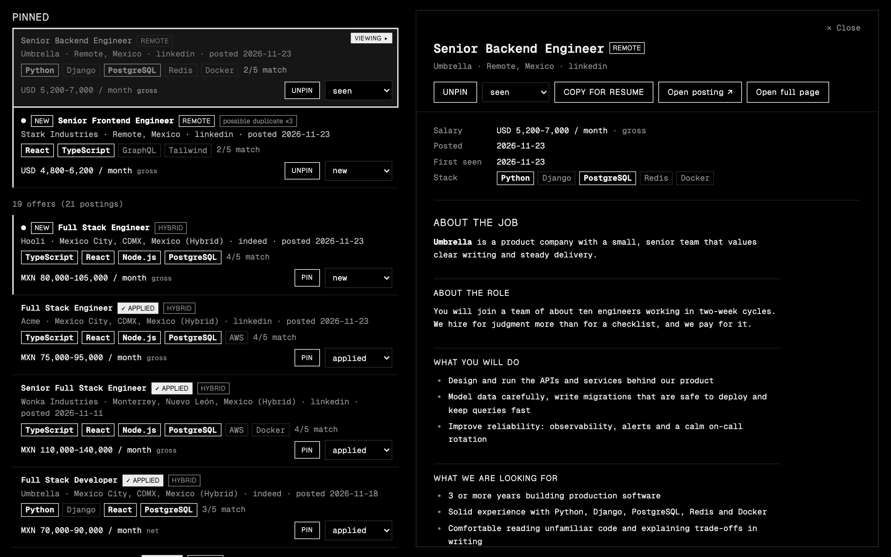
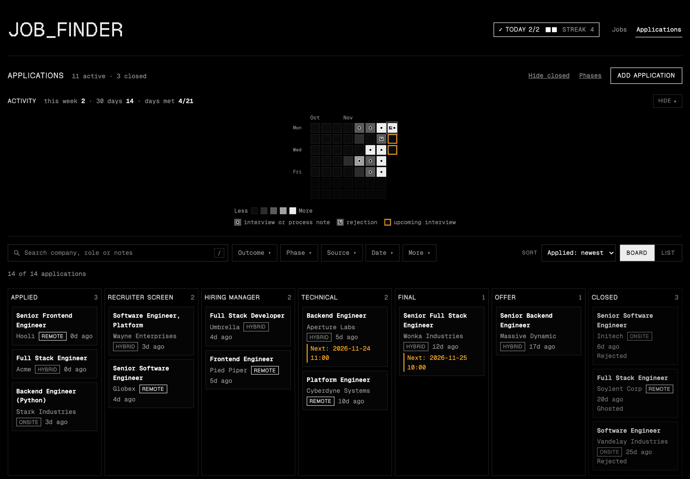
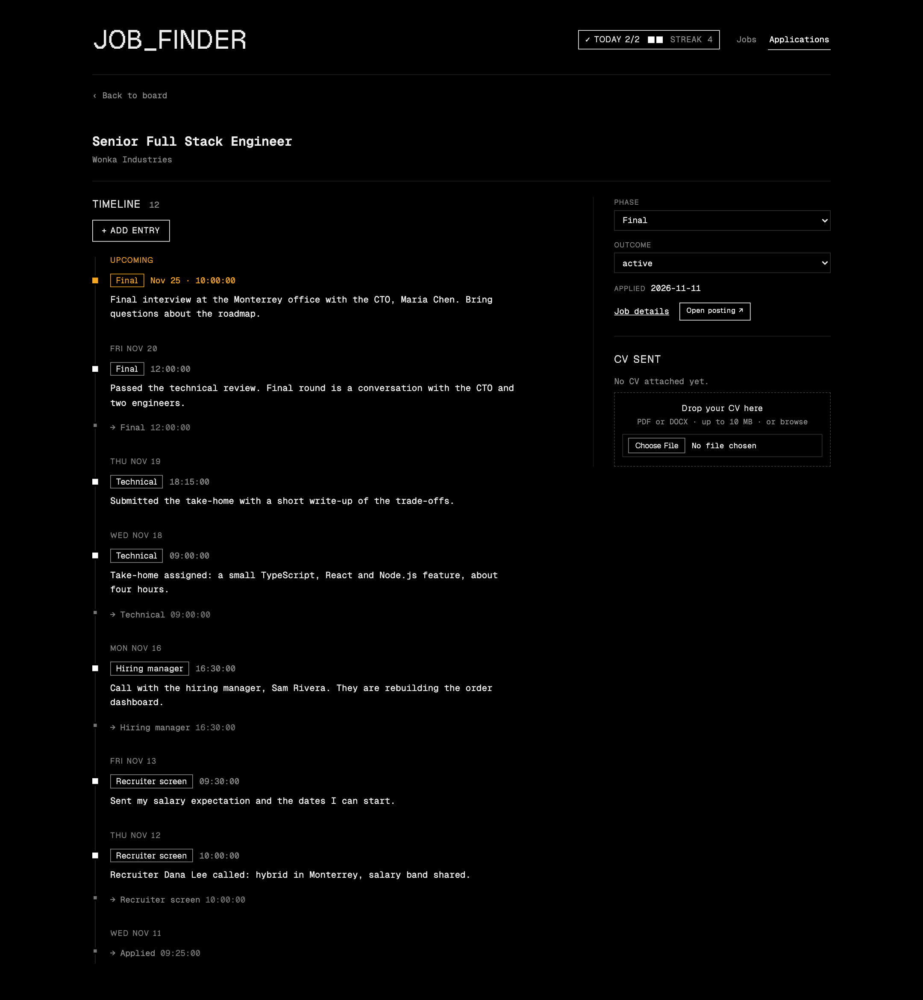

# job-finder

Private, local job search for **LinkedIn, Indeed and Glassdoor**. It runs on your machine, searches only when you press **SEARCH**, keeps everything in a SQLite file you own, and helps you track what you applied to.

It is built for **Mexico / Latin America by default** and is configurable: Indeed and Glassdoor country and your search places are plain config values. Be aware of what is tuned for that market today: salary parsing in posting text knows **MXN and USD**, and the work-mode and gross/net heuristics understand **Spanish and English**. It works elsewhere, with fewer salary and work-mode hits (see [Country and market](docs/configuration.md#country-and-market)).

Built on [JobSpy](https://github.com/speedyapply/JobSpy). It uses public search pages only and never logs in to any account.

## Features

- **On-demand search** across LinkedIn, Indeed and Glassdoor, for several terms and places; each search covers what was posted since the last one.
- **SQLite history** of every offer, with status (`new`, `seen`, `applied`, `discarded`) and pinning.
- **Duplicate grouping**: the same role found on several sites or reposted shows as one row.
- **Readable offers**: salary (MXN/USD) with gross/net, work mode (remote/hybrid/onsite), tidied descriptions, and your tech stack highlighted and ranked first.
- **Application tracker**: a board with customizable phases (drag and drop), a list view, a timeline per application, CV attachments and an activity calendar.
- **Daily goal** and weekday streak in the header.
- **Markdown export** of a day's offers, for pasting into a chat to review red flags.
- **Installable PWA** and a split list/detail view with keyboard navigation.
- **Optional AI resume tools**: a one-page PDF renderer and two agent prompts that work with Claude Code, Codex, OpenCode and pi.

## Screenshots

All three show **fictional demo data** (invented companies, people and notes), never a real search or database.



*Jobs: the list on the left, the selected offer on the right, with your stack highlighted and ranked first.*



*Applications: a board with your own phases, the activity calendar and the next interviews.*



*One application: every move and note on a timeline, with phase, outcome and CV on the side.*

## Prerequisites

Pick one way to run it:

| You need | For |
|---|---|
| `git` and **Python 3.11 or newer** | running it directly (the *local Python* quickstart) |
| `git` and **Docker with Compose** ([Docker Desktop](https://www.docker.com/products/docker-desktop/) on macOS/Windows, Docker Engine + Compose plugin on Linux) | running it in the background (the *Docker* quickstart) |

Optional, only if you want them:

- An AI coding tool (Claude Code, Codex, OpenCode or pi) for the [resume agents](#resume-tools-optional), or to let an AI agent set the project up for you (it follows [AGENTS.md](AGENTS.md)).
- poppler (`pdfinfo` / `pdftotext`) for a few resume PDF tests, which are skipped without it.
- Chrome or Chromium, only to regenerate the app icons with `scripts/make_icons.sh` and the README screenshots with `scripts/screenshots.sh`.

## Quickstart: local Python

```bash
git clone https://github.com/salvadorJimenez/job-finder.git
cd job-finder
python3 -m venv .venv
.venv/bin/pip install -e .
mkdir -p config && cp config.example.toml config/config.toml
.venv/bin/job-finder serve
```

`serve` prints `job-finder running at http://127.0.0.1:8000 (press Ctrl+C to stop)` and keeps running until you press **Ctrl+C**. Open that address and press **SEARCH**.

> **Windows:** use `python -m venv .venv` and `.venv\Scripts\pip install -e .`, then `.venv\Scripts\job-finder serve`. Replace the config command with `mkdir config` and `copy config.example.toml config\config.toml` (skip `mkdir` if the folder exists).

Your config is private (`config/` and `config.toml` are git-ignored). The app looks in the folder you run it from (normally the project folder): `config.toml` if it exists, otherwise `config/config.toml`; an existing root `config.toml` keeps working locally and wins if both exist. `--config PATH` uses exactly that file. If neither exists, the CLI exits with status 1 and a one-line hint: `config file not found: looked for config.toml and config/config.toml. Create it with: mkdir -p config && cp config.example.toml config/config.toml`.

**First try:** the example config works unchanged, so you can search right away. When you want results that fit you, edit these first (the `[search]` section is read on every search, no restart needed; details in [docs/configuration.md](docs/configuration.md)):

- `[search] terms`: the words to search for.
- `[search] location` and `country_indeed`: where to look (change them together).
- `[profile] stack`: your technologies, so matching offers are listed first (this one is read when the server starts).

**What happens when you press SEARCH:** the search runs on the server, one request per site, place and term. The page locks the list and shows a progress overlay with a step counter and the current step (`linkedin: software engineer · Mexico`); when the search ends, the page reloads and the panel shows the outcome. With the example config (3 terms, 1 place, 3 sites) expect **several minutes**, roughly 5 to 10: the 30 s pauses alone add about 3 minutes, and every offer's description is fetched. The very first search looks back 7 days, so it can take longer. More terms or places multiply the time and the chance that LinkedIn rate-limits you; a rate-limited site keeps the offers it returned before the block, gets no more requests in that search, and is retried by the next one (see [Rate limiting](docs/configuration.md#rate-limiting)). `job-finder search` runs the same search in the terminal and prints a progress line per step.

### Day to day (local Python)

```bash
.venv/bin/job-finder serve             # start again whenever you want it (Ctrl+C stops it)
.venv/bin/job-finder serve --reload    # development: restart when the code changes
```

- **Stop:** Ctrl+C in the terminal where `serve` runs. Nothing runs in the background, and your data stays in `data/`.
- **Update:** stop the server, then `git pull` and `.venv/bin/pip install -e .` again (it picks up new dependencies; database changes are applied automatically and never delete your data), then start it again. Contributors use `.venv/bin/pip install -e '.[dev]'` instead, which also installs the test tools.
- **Back up:** with the server stopped, copy `data/` (the SQLite database `data/jobs.db` and the CVs you attached, in `data/cvs/`) and `config/` (or `config.toml`, if that is where your config is) somewhere safe. If you use the resume tools, also copy `profile/` and `resumes/`. To restore, put them back in the project folder.
- **"Port 8000 … is already in use":** `serve` checks the port before starting and exits with that message when something else listens there, often job-finder running in Docker. Stop the other one, or use `--port 8001`.
- **Where things live:** `data/` (database and CVs), `exports/` (Markdown exports), `config/config.toml` or `config.toml` (your settings). The `[storage]` paths are relative to the config file's folder, except for a file inside a folder named `config`, where they are relative to the project folder; so `data/` and `exports/` stay next to `config/` with either layout. All of them are git-ignored.

## Quickstart: Docker

Keeps job-finder running in the background, also after a reboot.

```bash
mkdir -p config data exports && cp config.example.toml config/config.toml   # FIRST: see the notes below
docker compose up -d --build
docker compose ps                      # wait until STATUS says (healthy)
```

Open http://127.0.0.1:8000. "Today", the daily goal and the streak follow the container's time zone, which defaults to `America/Mexico_City`; set yours when starting:

```bash
TZ=Europe/Madrid docker compose up -d --build
```

> **Create `config/config.toml` before the first `docker compose up`.** `compose.yaml` mounts the `config/` **folder** (not one file), so any edit to the file, even with an editor that replaces it (atomic save, `sed -i`), is seen on the next search without restarting. If `config/` has no `config.toml`, the container exits with the one-line hint (`config file not found: looked for config.toml and config/config.toml. Create it with: mkdir -p config && cp config.example.toml config/config.toml`) and restarts until the file exists: read it with `docker compose logs`, create the file, and it starts by itself.

> **Moving an existing root config for Docker:** `mkdir -p config && mv config.toml config/config.toml` before `docker compose up -d --build`. Its content and your data stay as they are. The container does not see a root `config.toml`.

> **Create `data/` and `exports/` too (the `mkdir -p config data exports` above does it).** On Linux, Docker creates missing bind-mount folders owned by root, and the app runs as an unprivileged user (uid 1000), so it could not write the database. See the first Troubleshooting row if that already happened.

Install [Docker Desktop](https://www.docker.com/products/docker-desktop/) (macOS, Windows) or Docker Engine with the Compose plugin (Linux). On Docker Desktop, enable **Settings → General → Start Docker Desktop when you sign in**: the container has `restart: unless-stopped`, so it comes back whenever Docker starts. Stop any local `job-finder serve` first: it uses the same port and database. Use one or the other at a time.

### Day to day

```bash
docker compose ps                # is it running and healthy?
docker compose logs -f           # follow the logs (Ctrl+C stops following, not the app)
docker compose restart           # restart it
docker compose down              # stop it (your data stays in data/)
docker compose up -d --build     # after pulling or changing the code: rebuild and restart
```

Search and export from the terminal, inside the container:

```bash
docker compose exec job-finder job-finder search
docker compose exec job-finder job-finder export --date 2026-11-04   # writes exports/
```

### What lives where

| On your machine (project folder) | In the container | Notes |
|---|---|---|
| `config/` (holding `config.toml`) | `/app/config/` (read-only) | Edit `config/config.toml` on the host with any editor; the `[search]` section is read on every search, no restart or rebuild needed. A typo shows a notice on the page instead of breaking it. |
| `data/` | `/app/data` | Database and CVs. Removing the container or the image never deletes them. |
| `exports/` | `/app/exports` | Markdown exports. |

- **Private:** published on `127.0.0.1:8000` only, so nothing is reachable from your network. Inside the container it listens on all interfaces (`serve --host 0.0.0.0`) so Docker can forward to it.
- **Local time:** `TZ` in `compose.yaml` (default `America/Mexico_City`, override with the `TZ` environment variable as above). Without a time zone Docker uses UTC and "today" would change at the wrong hour for you.
- **No root:** the app runs as an unprivileged user inside the container.
- **Health:** Docker checks every 30 s that the app answers; `docker compose ps` shows `healthy` or `unhealthy`.
- **Backups:** copy the `data/` and `config/` folders (for example with the container stopped: `docker compose down`, copy, `docker compose up -d`).

### Troubleshooting

| Symptom | What to do |
|---|---|
| `port is already allocated` / `address already in use` | Something else uses port 8000, usually a local `job-finder serve`. Stop it, then `docker compose up -d`. |
| `docker compose ps` shows `unhealthy` or keeps restarting | `docker compose logs --tail 50` shows the error. |
| The app window says "job_finder is not running" | Docker is closed or the container is stopped: start Docker, then `docker compose up -d`. |
| Code changes don't show up | The container runs the code it was built with: `docker compose up -d --build`. |
| Dates or "today" look off by hours | Set `TZ` (see above), then `docker compose up -d`. |
| The container keeps restarting and `docker compose logs` shows `config file not found: looked for config.toml and config/config.toml …` | `config/` is missing or has no `config.toml` (Docker creates an empty, root-owned `config/` if it did not exist at the first `up`). Create the file: `mkdir -p config && cp config.example.toml config/config.toml` (or move your old one: `mv config.toml config/config.toml`). The container starts by itself on its next restart, no `up` needed. |
| Docker ignores my root `config.toml` | The container only mounts the `config/` folder. `mkdir -p config && mv config.toml config/config.toml`, then `docker compose up -d --build`. |
| Linux: the database cannot be created (`unable to open database file`) or `permission denied` under `data/` or `exports/` | Docker created those folders as root before you did, and the app runs as uid 1000. `docker compose down`, then `sudo chown -R 1000:1000 data exports`, then `docker compose up -d`. Creating the folders yourself first (`mkdir -p data exports`) also works when your own user id is 1000 (`id -u`); otherwise use the `chown`. |

To remove everything Docker created (your `data/` stays): `docker compose down --rmi local`.

## Configuration

Copy [`config.example.toml`](config.example.toml) to `config/config.toml` (see the quickstarts); every key is commented there. It works unchanged for a first try; edit `terms`, `location` / `country_indeed` and `[profile] stack` first. The essentials:

- **`terms`**: what to search for. **`sites`**: any of `linkedin`, `indeed`, `glassdoor`.
- **`location`**: one place, or an ordered list (`["Monterrey, Nuevo León, Mexico", "Mexico"]` is only an example of the list form). Prefer the full `City, State, Country` form.
- **`country_indeed`**: country for Indeed and Glassdoor. Change it together with `location` to search outside Mexico.
- **Requests multiply**: every term runs on every site in every place (terms × places × sites). If a site rate limits you (LinkedIn is the strictest), the search keeps what it got and stops asking that site; to avoid it, raise `pause_seconds` and lower `results_wanted`, or search fewer terms and places.
- **`[profile] stack`**: your technologies; offers that mention more of them are listed first. The example values are placeholders for you to replace.
- **`[goal] daily`**: applications per weekday (default 5, `0` turns the goal off).
- **`[storage]`**: where the SQLite database and the Markdown exports go (`data/jobs.db`, `exports/`), relative to the config file's folder, or to the project folder when the file is in a folder named `config`.

The `[search]` section is read on every search; the other sections when the server starts. Full reference: [docs/configuration.md](docs/configuration.md).

## Usage

```bash
.venv/bin/job-finder serve                              # web page at http://127.0.0.1:8000
.venv/bin/job-finder serve --reload                     # same, restarting whenever the code changes
.venv/bin/job-finder serve --host 127.0.0.1 --port 8001 # override [web] host/port for this run
.venv/bin/job-finder search                             # run the same search from the terminal
.venv/bin/job-finder export --date 2026-11-04           # writes exports/jobs-2026-11-04.md
.venv/bin/job-finder export --date 2026-11-04 --stdout  # prints it instead
.venv/bin/job-finder --config other.toml search         # --config goes before the subcommand
```

The server listens on `127.0.0.1` only, so nothing is exposed to your network, and form posts coming from other websites are refused.

**The web UI in brief:** the **Jobs** page lists offers (filter by status, source, work mode, stack, salary and more; click one to read it in the side pane); marking one `applied` opens its application page. **Applications** is the tracker: a board by phase (or a list), the activity calendar, and a timeline with notes and the CV you sent. The header shows your daily goal and streak.

**Install as an app:** the page is a PWA. In Chrome or Edge (Windows, macOS, Linux) click the install icon in the address bar; in Safari on macOS use **File → Add to Dock**. It only works while the server runs.

Detailed reference, with everything the UI does:

- [docs/features.md](docs/features.md): searching, the listing, split view, filters, duplicates, export, PWA.
- [docs/applications.md](docs/applications.md): application phases, board and list, application page, daily goal, activity calendar.
- [docs/configuration.md](docs/configuration.md): every `config.toml` key, first-try guidance, how long a search takes, locations, rate limiting.
- [docs/ai-agents.md](docs/ai-agents.md): the resume agents for Claude Code, Codex, OpenCode and pi.

## Resume tools (optional)

Not needed to search or track applications. They turn your own career notes into a tailored one-page resume.

- **Two AI agents**, `resume-writer` (tailors a resume to a pasted job description) and `resume-pdf` (renders an approved resume and checks the page count). They work with **Claude Code, Codex, OpenCode or pi**; you only need one of those tools. Setup and usage per tool: [docs/ai-agents.md](docs/ai-agents.md).
- **A PDF renderer** you can use on its own, with any Markdown resume of the supported shape (below), no AI tool required.

To start:

1. Copy the template folder and fill it in. `profile/` and `resumes/` are git-ignored, so your career facts and generated resumes stay private:

   ```bash
   cp -R profile.example profile
   ```

   Start with `profile/01-identity.md`, `02-experience.md`, `03-skills.md` and `05-education.md`; see [`profile.example/README.md`](profile.example/README.md) for the file list and the evidence levels.

2. Install the renderer's extra dependency (ReportLab; the app and the Docker image do not need it):

   ```bash
   .venv/bin/pip install -e '.[resume]'
   ```

3. Render an approved `resume.md` into the PDF:

   ```bash
   .venv/bin/python scripts/render_resume.py resumes/<job>/resume.md --out resumes/<job>/Resume_<First>_<Last>_<Company>.pdf
   ```

   Exit codes: `0` wrote the PDF; `2` the content does not fit on one page (the message gives the overflow and the longest block) and no file is left behind; `1` any other error (unreadable file, Markdown outside the supported shape — the message names the line — or ReportLab missing). The PDF title and author come from the resume's `# Name` heading.

**Supported Markdown shape:** `# Name`, then a headline and contact lines; `## Section`s holding paragraphs and `- bullets`; `### Company — Title` roles followed by a `*dates*` line; inline `**bold**` and `*italic*` only. Anything else is an error. The script's docstring (`scripts/render_resume.py`) is the contract. The page layout (US Letter, Helvetica, teal headings, margins, length budget) is specified in [`profile.example/10-cv-structure.md`](profile.example/10-cv-structure.md). Teal, the fonts and the margins are design defaults, not requirements: change the constants at the top of `scripts/render_resume.py` (and the template file to match) to restyle it. Your name, contact line, headline, section content and PDF file name all come from your own `resume.md` and `profile/`, never from the script.

**The agents in short:** `resume-writer` writes `resume.md` and `match-report.md` under `resumes/<company>-<role>/`; `resume-pdf` renders the approved resume with the script above. Both run from the repository root and stop with a hint to copy `profile.example/` if `profile/` is missing. They only use facts from `profile/`; `profile/06-cv-rules.md` holds your hard rules, which override the agent prompts. The job page's **COPY FOR RESUME** button copies an offer as text ready to paste into the writer's prompt. How to invoke them in each tool: [docs/ai-agents.md](docs/ai-agents.md).

## Project layout

```
jobfinder/             the application package
  templates/ static/   Jinja2 pages, CSS/JS, fonts, PWA icons and service worker
scripts/               render_resume.py, import_applications.py, make_icons.sh, demo_data.py, screenshots.sh
tests/                 pytest suite
docs/                  detailed reference (features, applications, configuration, ai-agents) and screenshots/
profile.example/       empty templates for the resume knowledge base
agents/                canonical resume-writer and resume-pdf prompts (see docs/ai-agents.md)
.claude/agents/ .codex/agents/ .opencode/agents/ .pi/agents/
                       thin wrappers that point the AI tools to agents/
config.example.toml    documented example config (copy to config/config.toml)
compose.yaml           Docker Compose service (Dockerfile builds the image)
AGENTS.md              guide for coding agents and contributors
```

Private and git-ignored: `config/`, `config.toml`, `data/`, `exports/`, `profile/`, `resumes/`.

## Development

```bash
.venv/bin/pip install -e '.[dev]'
.venv/bin/python -m pytest -q
.venv/bin/job-finder serve --reload
```

- Optional tools: poppler's `pdfinfo` / `pdftotext` (`brew install poppler`, `apt install poppler-utils`) enable a few resume PDF checks, which are skipped without them. Chrome or Chromium is needed only by `scripts/make_icons.sh` (app icons) and `scripts/screenshots.sh` (the README screenshots, taken from fictional data seeded by `scripts/demo_data.py` into a throwaway folder; it serves on port 8790, never 8000, and never reads your `data/`). Set `CHROME=/path/to/chrome` if it is not on your `PATH`.
- Conventions in short: write the test first for any behavior change and test through the public interface (the web app with `TestClient`, or the CLI); update this README, `docs/` and the `--help` text with any user-visible change; English for code, comments, docs and commit messages; [Conventional Commits](https://www.conventionalcommits.org/); small, reviewable diffs; no new dependencies without need. Full details, architecture and gotchas are in [AGENTS.md](AGENTS.md).

## Contributing

Issues and pull requests are welcome. Open an issue first for larger changes. Please follow [AGENTS.md](AGENTS.md): tests for behavior changes, docs updated, Conventional Commit messages, and no personal data (use fictional people and companies in tests and examples).

## Disclaimer

job-finder reads public search pages through JobSpy and never logs in to any account. Respect each site's terms of service and rate limits; scraping may be restricted by them. Keep your usage personal and moderate (the pauses and result limits in the config exist for that). You are responsible for how you use it. Offer data is shown as published and may be wrong or out of date.

## License

[MIT](LICENSE).

The Geist Mono and Geist Pixel fonts are vendored from the `geist` package under the SIL Open Font License (`jobfinder/static/fonts/OFL-LICENSE.txt`).
